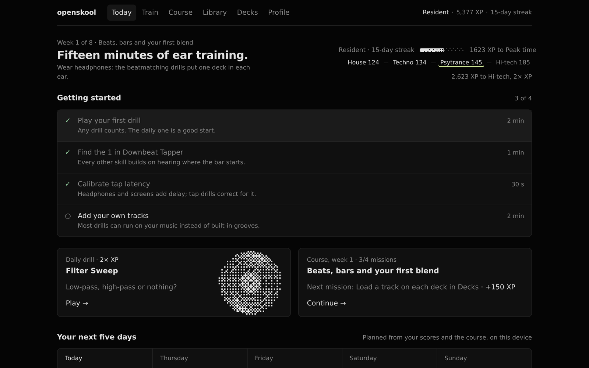
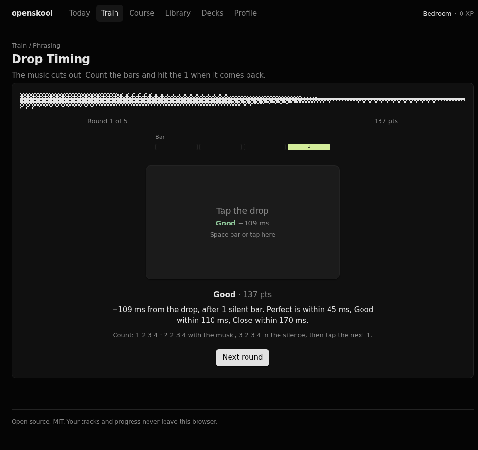
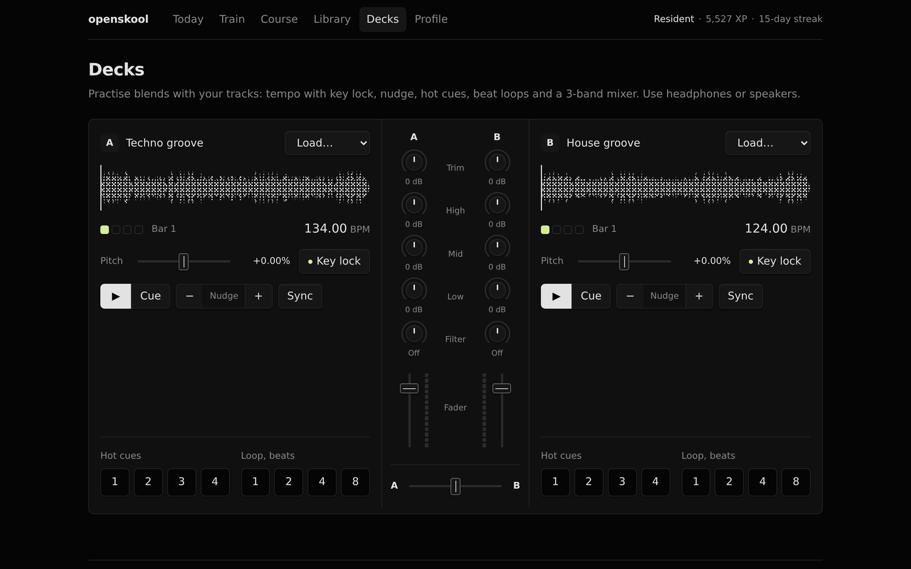
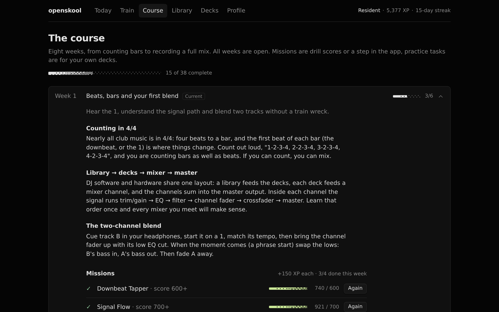
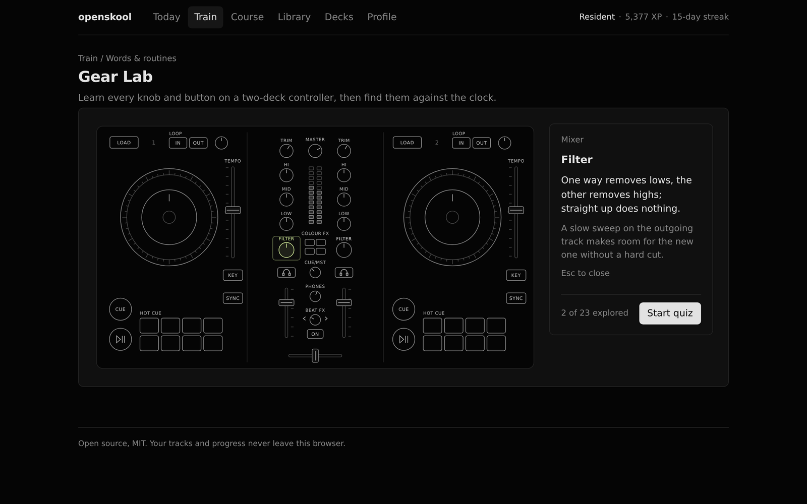

# openskool

Open-source ear training for DJs. Bring your own songs.

openskool is a free, local-first trainer for the skills DJ schools teach: hearing the 1, beatmatching
by ear, phrasing, EQ, filters, loops, FX, keys and set flow. Add your own tracks and most audio
drills run on your music. There is no account and no server: tracks and progress stay in your
browser.



## What's in it

- **20 drills** across seven skills. Every drill is scored out of 1000 and gets harder as the rounds go on.

  | Skill | Drills |
  | --- | --- |
  | Rhythm & time | Feel the Time, Downbeat Tapper, BPM Math |
  | Beatmatching | Sync Check, Tempo Match, Tap Tempo |
  | Phrasing | Drop Timing, Phrase In |
  | Mixing & EQ | EQ Detective, Filter Sweep, Gain Match, Bass Clash |
  | FX & loops | Loop Lab, FX Spotter |
  | Sets & keys | Genre ID, Camelot Keys, Set Builder |
  | Words & routines | Vocab Blitz, Signal Flow, Gear Lab |

- **Fair rounds.** Answers stay locked until the change has played. A beat strip marks the moment
  ("Cut", "Deck B in", "↓"), and in the counting drills it hides partway so you count in your head.
  Tap drills grade each tap live (Perfect, Good, Close, Off). Every round ends with what happened,
  in numbers, and a tip for using it in a mix.
- **Your tracks.** Files are decoded and analysed in a Web Worker: tempo, beat grid, downbeat, 8-bar
  phrase start, key (Camelot) and energy. If the analysis gets something wrong, fix it in the grid
  editor. Until you add music, synthesized grooves fill in: house 124, techno 134, psytrance 145 and
  hi-tech 185.
- **Tempo worlds.** Faster tempos are harder and pay more XP (up to 2×). Each world keeps its own
  best scores. Nothing is locked.
- **An 8-week course** that starts with counting bars and ends with recording a final mix. Each week
  has lessons, missions and practice tasks for your own decks. Every week is open from the start.
- **A practice coach** that plans your next five days. It weighs your recent form per skill, the
  current course week and spaced review. It runs on your device.
- **Practice decks**: two decks with key lock, pitch ±8 %, nudge, sync, hot cues and beat loops, and
  a mixer with 3-band EQ, filter, trim, faders and a crossfader.
- **Gear Lab**: a drawn 2-deck controller and mixer. Explore what each control does, then take a
  find-the-control quiz.
- **Tap latency calibration**, so the timing drills stay fair on Bluetooth headphones.
- **XP, ranks, badges, streaks and a daily drill** worth 2× XP. Export and import your progress as JSON.
- **Installable** as an app (PWA) that works offline. Once it's installed, you can share audio files
  to it from other apps.

| | |
| --- | --- |
|  |  |
|  |  |

Wear headphones. The beatmatching drills put one deck in each ear, and phone speakers can't
reproduce the bass that EQ Detective and Bass Clash depend on.

## Run it

Requires Node 20.19+ or 22.12+.

```sh
npm install
npm run dev     # http://localhost:5173
npm test        # analysis, coach and XP tests
npm run lint
npm run build   # static site in dist/
```

The build is a static site with hash routing, so you can deploy `dist/` to any static host
(GitHub Pages, Netlify, Cloudflare Pages or any web server) without rewrites. The service worker
only registers in production builds.

## How it works

| Area | Where |
| --- | --- |
| Tempo, grid, phrase, key and energy analysis (pure, tested) | `src/audio/analyze.ts` |
| Built-in groove synthesizer | `src/audio/synth.ts` |
| Playback, DJ EQ and filter, tap timing | `src/audio/engine.ts` |
| Library in IndexedDB, analysis worker | `src/lib/library.ts` |
| Drills | `src/drills/` |
| Course content and missions | `src/lib/course.ts` |
| Coach, daily drill, badges | `src/lib/coach.ts` |
| Progress, XP, tempo worlds (localStorage) | `src/lib/progress.ts` |
| Dithered meters and visuals | `src/components/viz/`, engine in `src/lib/dither/` |

Tap timing runs on the audio clock. Each tap's time is mapped through
`AudioContext.getOutputTimestamp()`, so it is compared with what you actually heard, then corrected
by your calibration offset.

## Contributing

Issues and pull requests are welcome. Run `npm test`, `npm run lint` and `npm run build` before
opening a PR. CI runs the same checks.

- A drill is a React component. It receives a clip source and calls `onDone(score, detail)`.
- Most listen-and-choose drills take only a few lines on top of `ChoiceDrill` in
  `src/drills/common.tsx`. A round's `play()` returns its timing, which drives the answer lock and
  the beat strip.
- Course weeks, lessons and missions are plain data in `src/lib/course.ts`.

`.agents/skills/` and `.claude/skills/` contain the dithercn agent skill, for coding agents working
on the visuals.

## Credits

- The dither engine in `src/lib/dither/` is [dithercn](https://github.com/opencoredev/dithercn)
  (MIT; its licence is kept beside the code).
- The drill set is inspired by [homeskool.space](https://homeskool.space). openskool is an
  independent project, not affiliated with it, and its code, audio and text are its own.

## License

[MIT](LICENSE)
